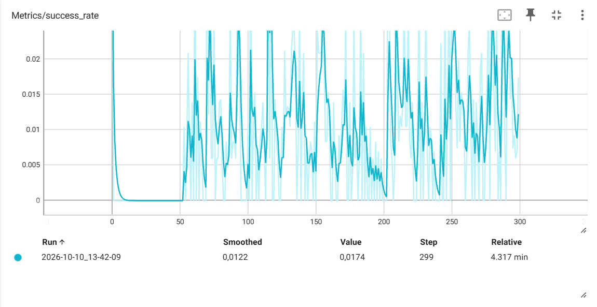
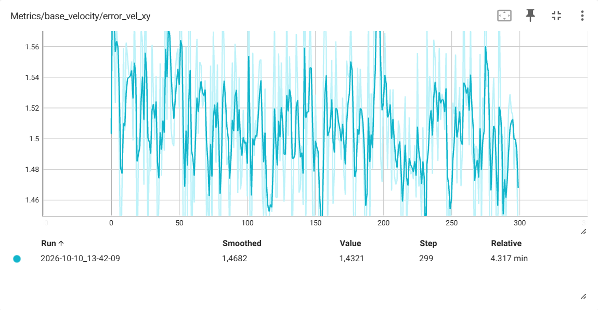
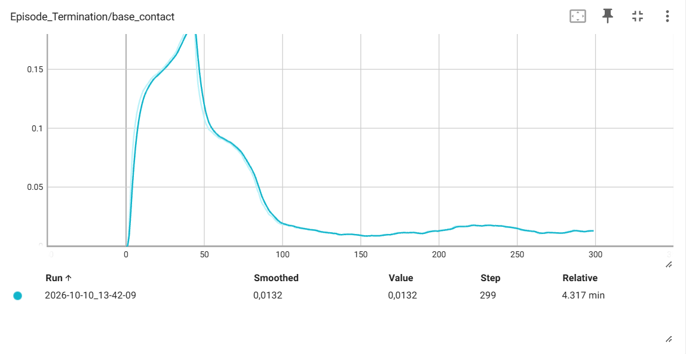
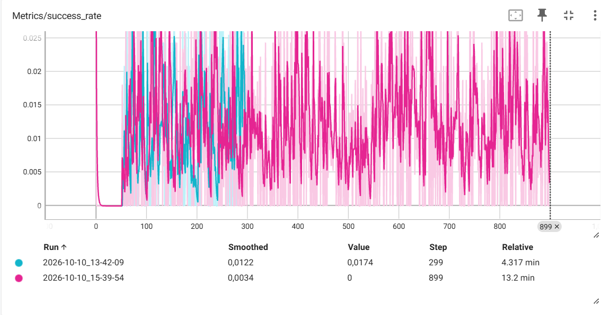
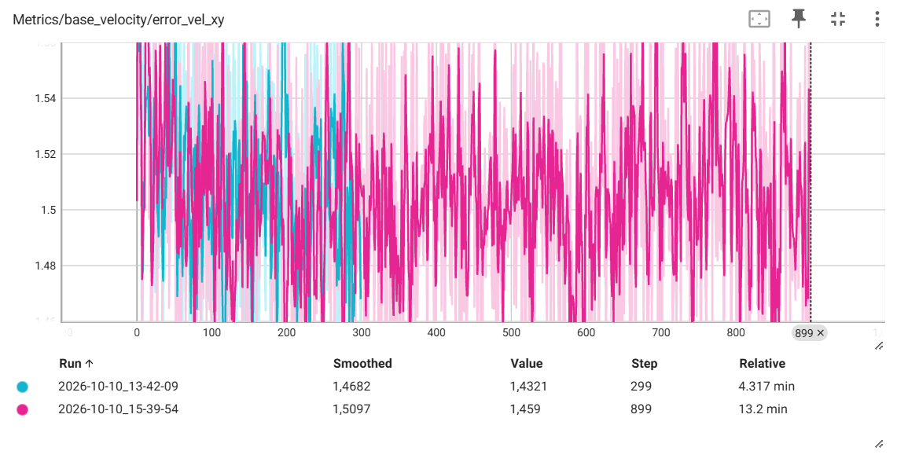
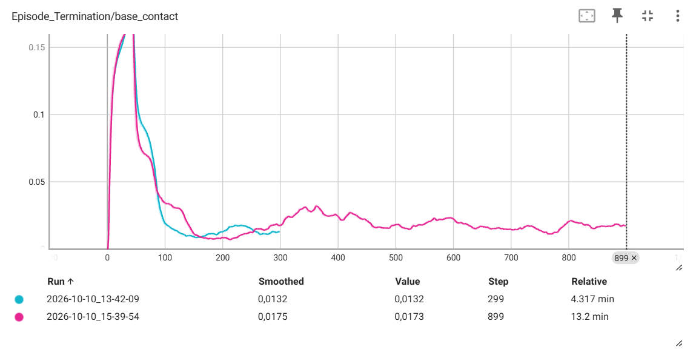
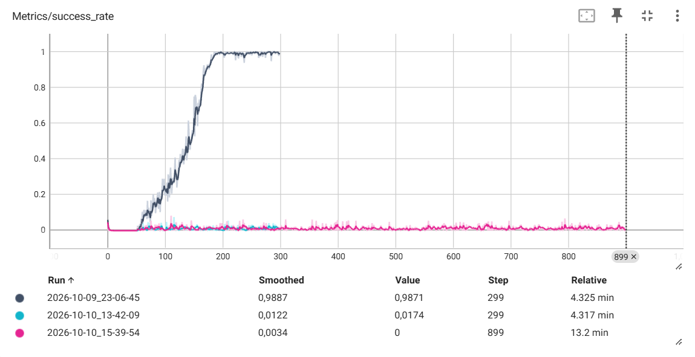
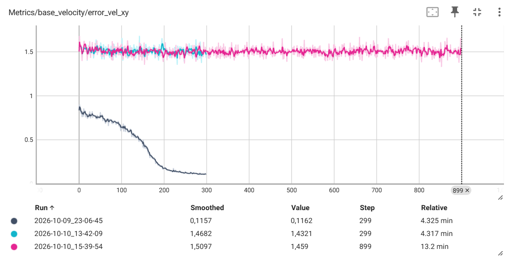
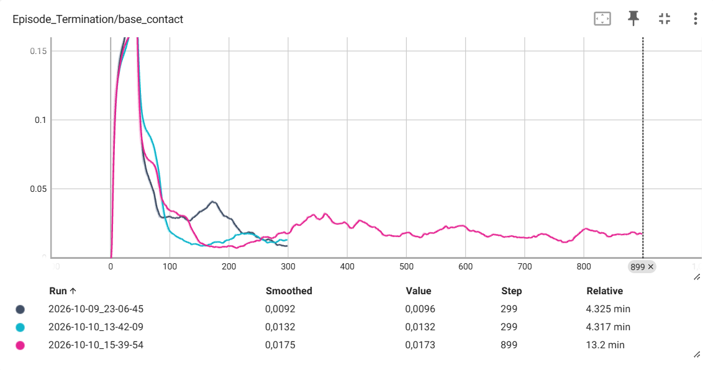
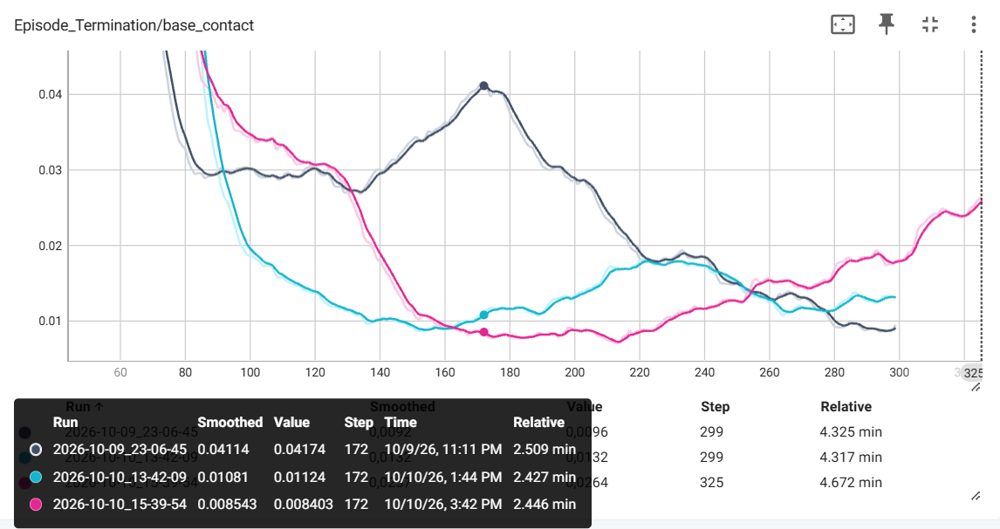

# My REPORT

## Your prediction, written before you ran the experiment.

I think doubling the linear velocity will force Go2 robot to chaotically spin its engines just to move in said direction. My prediction: I will see all robots randomly spinning their legs and falling almost instantly.

## What actually happened, with the metrics to support it.

As I initialized my new running policy I was confused: they crossed their legs just not to fall on their backs. Then I realised they do so because of the reward function. In my hypothesis I completely forgot that the reward function includes robot standing on its legs. As a matter of fact, reward function prioritizes teaching Go2 to not fall by any means. 

## Did more training iterations fix it? If yes, what does that tell you about the cause? If no, what does that rule out?

I went from 300 to 900 iterations, but there was almost no difference at all. Go2 robots were still standing their ground without moving. The only noticed movement was their ability to roll from one leg to another, yet that did not change the fact that they were not going for their objective.

It is hard to notice any difference by only watching the running policy. That is when TensorBoard becomes very useful. 

Here purple is our 899 iterations model and blue is 299 iterations one. As graphs illustrate, all three metrics did not show an important progress over time. However, base_contact_termination graph tells us that model fell less over time. To study this further it is best to add the third line: policy with regular velocity range of (-1.0, 1.0). I will call it our first model. This will help us understand the true difference between real success and fake one. 

Here we clearly see that our first model reached its success_rate peak somewhere at 200th iteration and reached a plateau, while the other two immediately started on a plateau.

The same goes for our error_vel_xy. As first model's success_rate grows, its error_vel_xy falls. The other models failed to improve.

Here goes the most interesting part. We see that all three models followed the same trend: they all stayed on their legs most of the time. However, near 170th iterations our first model fell more than the other two:

I believe that is because our first model actually tried to walk toward the goal and because of that failed three to five times more. At almost 300 iterations our first model had the lowest number of falls out of the three. 